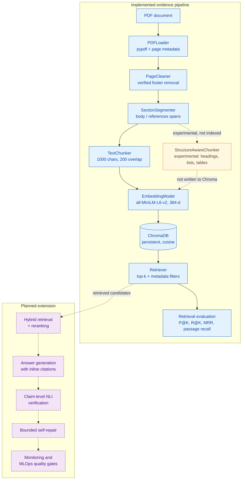

# EvidenceRAG — Long-Document RAG with Citation Verification, Self-Repair and MLOps Monitoring

**A research-oriented retrieval system for answering questions over long research papers with traceable, page-level evidence.**

> **Project status:** research prototype. The ingestion, chunking, embedding, retrieval and retrieval-evaluation layers are implemented and tested. Answer generation, claim-level NLI verification, bounded self-repair, hybrid search and MLOps monitoring are **planned**, not built. See [Implemented vs. planned](#implemented-vs-planned).

[](https://www.python.org/)
[](#testing)
[](https://pytest.org/)
[](https://www.trychroma.com/)
[](https://huggingface.co/sentence-transformers/all-MiniLM-L6-v2)
[](#current-limitations)

---

## Table of contents

- [Problem statement](#problem-statement)
- [Project objectives](#project-objectives)
- [System architecture](#system-architecture)
- [Implemented vs. planned](#implemented-vs-planned)
- [Implemented features](#implemented-features)
- [Technology stack](#technology-stack)
- [Repository structure](#repository-structure)
- [Retrieval evaluation and results](#retrieval-evaluation-and-results)
- [Installation and setup](#installation-and-setup)
- [Usage](#usage)
- [Testing](#testing)
- [Current limitations](#current-limitations)
- [Future roadmap](#future-roadmap)
- [Research and engineering highlights](#research-and-engineering-highlights)
- [Author](#author)

---

## Problem statement

Long technical documents are poorly served by "embed everything and hope" pipelines:

1. **Fixed-character chunking breaks meaning.** A 1,000-character window cuts sentences, splits tables, and separates a heading from the text it introduces. Retrieval then returns fragments that look relevant but cannot support a citation.
2. **Publisher boilerplate pollutes evidence.** Repeated footers and licence banners dominate short windows and are retrieved as if they were content.
3. **A passage is not a citation.** Without stable page numbers and character offsets, a generated answer cannot be audited back to the source.
4. **Retrieval alone is not an answer.** A language model can still invent or overstate claims. Trustworthy RAG needs **claim-level verification**—checking each generated claim against the retrieved evidence—and a **bounded repair loop** that revises or removes unsupported claims instead of silently presenting them.
5. **Quality is unmeasured.** Chunking, cleaning and retrieval choices must be compared against reviewed relevance judgments, not intuition.

EvidenceRAG is being built around these failure modes. The current repository provides the **auditable evidence layer**: page-aware ingestion, conservative cleaning, section segmentation, two chunking strategies, semantic indexing, retrieval, and a reproducible retrieval evaluation. The verification and self-repair layers build on that foundation in later stages.

---

## Project objectives

| # | Objective | Status |
|---|---|---|
| 1 | Extract page-level text and metadata from PDFs | Implemented |
| 2 | Remove only verified publisher furniture, without rewriting text | Implemented |
| 3 | Separate body content from references with fail-open detection | Implemented |
| 4 | Provide a fixed-window chunking baseline with exact offsets | Implemented |
| 5 | Build a structure-aware chunker (headings, lists, tables, sentences) | Implemented (experimental) |
| 6 | Generate 384-dimensional semantic embeddings with truncation diagnostics | Implemented |
| 7 | Persist vectors and metadata in ChromaDB with deterministic IDs | Implemented |
| 8 | Retrieve top-k evidence with metadata filters | Implemented |
| 9 | Evaluate retrieval with reviewed judgments and standard metrics | Implemented |
| 10 | Add hybrid retrieval and reranking | Planned |
| 11 | Generate answers with inline, verifiable citations | Planned |
| 12 | Verify each claim with Natural Language Inference | Planned |
| 13 | Repair unsupported claims within a bounded loop | Planned |
| 14 | Add monitoring, drift checks and MLOps quality gates | Planned |

---

## System architecture

Solid arrows are implemented. Dashed arrows are planned or explicitly not yet wired into the indexed path.



**Design principles behind the architecture**

- Every stage is a small, independently testable module with a typed dictionary contract.
- Character offsets always refer to the text a stage actually received, and the pipeline verifies the invariant before embedding.
- Detection is conservative and **fails open**: uncertain cleaning keeps text, an unconfirmed references heading leaves the page as body, and unclassified blocks remain prose.
- The experimental chunker is injectable but not the default, so existing collections remain reproducible.

---

## Implemented vs. planned

| Capability | Status | Notes |
|---|---|---|
| PDF text extraction | **Implemented** | `pypdf`, one record per page |
| Publisher-footer cleaning | **Implemented** | Exact IJERT signature; auditable report |
| Body/references segmentation | **Implemented** | Conservative, fail-open |
| Fixed-window chunking | **Implemented** | Default pipeline chunker |
| Structure-aware chunking | **Implemented (experimental)** | Not the default; no collection created |
| Semantic embeddings | **Implemented** | `all-MiniLM-L6-v2`, 384-d |
| ChromaDB persistence | **Implemented** | Cosine space, deterministic upserts |
| Semantic retrieval | **Implemented** | `top_k`, metadata `where` filters |
| Retrieval evaluation | **Implemented** | 6 reviewed questions, k=3/5 |
| Automated tests | **Implemented** | 205 collected; 204 pass, 1 optional skip |
| Hybrid retrieval / reranking | **Planned** | No code yet |
| Answer generation with citations | **Planned** | No LLM or generation code |
| Claim-level NLI verification | **Planned** | No NLI model or code |
| Bounded self-repair | **Planned** | No repair loop |
| Monitoring / MLOps gates | **Planned** | Only offline evaluation exists |
| Web UI / API | **Planned** | Python API only |

---

## Implemented features

### 1. Page-level PDF ingestion

`ingestion/pdf_loader.py`

- Reads PDFs with `pypdf` and returns one `{text, metadata}` record per page.
- Metadata: `source`, `source_path`, `page_number`, `total_pages`.
- Validates extension, existence, encryption and parse failures.
- Can skip or retain empty pages; page numbers always reflect the original PDF.

### 2. Conservative page cleaning

`ingestion/page_cleaner.py`

- Removes the repeated IJERT footer block and page-number line (`IJERTV15IS061078 Page N`).
- Only whole trailing lines are removed; text is never reflowed, dehyphenated or joined.
- Requires at least three qualifying trailing lines and at least one exact signature match.
- Returns a `CleaningReport` (`footer_detected`, removed lines, character counts, ratio).
- Fails open: an uncertain block leaves the page unchanged.

### 3. Body / references segmentation

`ingestion/section_segmenter.py`

- Finds a standalone uppercase references heading (`REFERENCES`, `XIII. REFERENCES`, …) in the back half of the document.
- Requires at least three ascending numbered entries (`[1]`, `[2]`, `[3]`, …) before confirming the boundary.
- Returns page-aware `{page_number, section, start, end}` spans and labels existing chunks.
- Also exposes `section_text()` and `reference_entries()` for downstream citation work.
- If no heading is confirmed, the document is treated as body (fail open).

### 4. Fixed-window chunking baseline

`ingestion/text_chunker.py`

- Default pipeline chunker: 1,000-character windows with 200-character overlap.
- Chunks never cross page boundaries.
- Guarantees `page_text[char_start:char_end] == chunk["text"]`.
- Serves as the reproducible baseline (`evidence_chunks` / `evidence_chunks_v2` in Stage 6D).

### 5. Structure-aware chunking (experimental)

`ingestion/structure_chunker.py`

`StructureAwareChunker` implements the same `chunk_documents(documents)` protocol, so it can be injected into the pipeline. It is **not** the default and has **not** been indexed into a third collection.

What it does:

- **Heading detection:** Roman (`I.`, `XIII.`), alphabetic (`A.`), numeric (`2.1`) and standalone all-caps headings.
- **Heading hierarchy:** maintains a level stack and emits `heading_path` such as `I. INTRODUCTION > A. Background`.
- **Heading attachment:** a heading travels with the first content chunk; later chunks inherit the path without duplicating text.
- **Sentence-aware packing:** protects abbreviations (`et al.`, `Fig.`, `Dr.`), initials, decimals (`3.14`), citations (`[1][2]`), e-mail addresses and URLs before splitting.
- **Lists:** groups numbered and bulleted items between structural boundaries.
- **Tables:** caption-first detection, a strong short-line row-run test, a 1,200-character forward search, and a stable `table_id` when the caption and rows must remain separate chunks.
- **Formulas:** symbol-heavy lines are kept intact instead of being sentence-split.
- **References:** entries are parsed with the existing `ENTRY_PATTERN` and emitted as citation units.
- **Hard section boundaries:** body and references are never combined in one chunk.
- **Page-local output:** preserves the scalar citation model (`page_number`, `char_start`, `char_end`); page-boundary cuts are recorded in metadata.
- **Token budget:** ~190-token target, 254-token hard ceiling including special tokens.
- **Deterministic output:** no randomness, stable ordering, stable table IDs.
- **Scalar-only metadata**, compatible with Chroma: `chunking_version`, `structure_type`, `structure_confidence`, `heading_path`, `heading_level`, `heading_text`, `table_id`, `table_caption`, `table_part`, `block_index`, `starts_mid_sentence`, `ends_mid_sentence`, `is_forced_split`, `overlap_sentences`.

### 6. Semantic embeddings

`ingestion/embedding_model.py`

- `sentence-transformers/all-MiniLM-L6-v2`, 384 dimensions, CPU by default.
- Batch size 32; model loaded once per process.
- Counts tokens with truncation disabled and stores `token_count`, `is_truncated`, `embedding_model`.
- Emits a warning when a chunk exceeds the model's 256-token limit; the full text is always retained.
- `embed_texts()` embeds raw queries; `embed_chunks()` preserves all existing metadata.

### 7. Persistent vector storage

`retrieval/vector_store.py`

- `chromadb.PersistentClient` at `data/chroma` by default.
- Cosine distance; `similarity = 1 - distance`.
- Deterministic IDs derived from `source_path`, `page_number` and `chunk_index`, so re-ingestion upserts instead of duplicating.
- Validates 384-dimensional, finite embeddings and scalar-only metadata.
- Supports metadata filters (`source`, `page_number`, `section`, …), deletion, and collection counts.
- Two collections exist locally: `evidence_chunks` (baseline) and `evidence_chunks_v2` (cleaned pages + section metadata).

### 8. Semantic retrieval

`retrieval/retriever.py`

- Embeds one query with the existing model and returns the top-k nearest chunks.
- Optional Chroma `where` filter, e.g. `{"section": "body"}`.
- Returns `id`, `text`, `metadata`, `distance` and `similarity`.
- Does not generate answers, rerank, or load a second model.

### 9. Retrieval evaluation

`evaluation/`

- Six manually reviewed questions over the sample paper.
- Gold evidence is stored as **literal text snippets**, not chunk IDs, so labels are re-verifiable and survive re-chunking.
- Relevance rule: on the same page, a chunk overlaps a gold passage by at least 50% of **either** the chunk or the passage.
- Metrics: Precision@K, Recall@K, MRR, passage recall, plus threshold sensitivity (0.3 / 0.5 / 0.7).
- Diagnostics: publisher furniture, reference-only hits, truncated chunks and boundary cuts.
- Machine-readable outputs: `stage6d_results.json`, `stage6d_retrieval.csv`, `stage6d_report.md`.

### 10. Automated tests

- 205 tests collected across 10 modules.
- 204 pass; 1 optional test is skipped unless `EVIDENCERAG_SAMPLE_PDF` is set.
- Coverage includes loaders, cleaning, segmentation, both chunkers, embeddings, vector storage, retrieval, evaluation metrics and the end-to-end pipeline.

---

## Technology stack

| Layer | Technology | Version verified locally |
|---|---|---|
| Language | Python | 3.13.5 |
| PDF parsing | `pypdf` | 7.1.0 |
| Embeddings | `sentence-transformers/all-MiniLM-L6-v2` | 6.3.0 |
| Vector database | ChromaDB (persistent client, cosine) | 1.5.9 |
| Numerical arrays | NumPy | 2.5.4 |
| Testing | pytest | 9.2.0 |
| Model runtime | PyTorch / Transformers (transitive) | 2.15.0 / 5.23.0 |

There is no web framework, LLM provider, NLI model or orchestration dependency in the current repository. No lockfile or `requirements.txt` exists yet; the versions above are the ones the test suite and sample-paper runs were verified against.

---

## Repository structure

```text
EvidenceRAG/
├── ingestion/
│   ├── pdf_loader.py           # pypdf → page documents + metadata
│   ├── page_cleaner.py         # verified footer removal + cleaning report
│   ├── section_segmenter.py    # body / references spans, chunk labelling
│   ├── text_chunker.py         # fixed-window baseline (default)
│   ├── structure_chunker.py    # structure-aware experimental chunker
│   ├── embedding_model.py      # all-MiniLM-L6-v2 embeddings + token counts
│   └── pipeline.py             # end-to-end ingestion orchestration
├── retrieval/
│   ├── retriever.py            # query embedding + top-k search
│   └── vector_store.py         # ChromaDB persistence, validation, filters
├── evaluation/
│   ├── metrics.py              # P@K, R@K, MRR, passage recall
│   ├── relevance.py            # reviewed questions + gold snippets
│   ├── run_retrieval_eval.py   # read-only v1 vs v2 comparison
│   └── results/
│       ├── stage6d_report.md
│       ├── stage6d_results.json
│       └── stage6d_retrieval.csv
├── tests/
│   ├── test_pdf_loader.py
│   ├── test_page_cleaner.py
│   ├── test_section_segmenter.py
│   ├── test_text_chunker.py
│   ├── test_structure_chunker.py
│   ├── test_embedding_model.py
│   ├── test_vector_store.py
│   ├── test_retriever.py
│   ├── test_pipeline.py
│   └── test_evaluation.py
├── data/
│   ├── raw/                    # source PDFs (gitignored)
│   └── chroma/                 # local Chroma persistence (gitignored)
├── .gitignore
└── README.md
```

`data/raw/*.pdf` and `data/chroma/` are intentionally excluded from version control. Add your own PDF to `data/raw/` before running ingestion.

---

## Retrieval evaluation and results

### Evaluation design

| Item | Setting |
|---|---|
| Document | One six-page research paper (Vyapar AI) |
| Cleaned text | 27,213 characters |
| Questions | 6, manually written and reviewer-labelled |
| Collections | `evidence_chunks` (v1, baseline) vs `evidence_chunks_v2` (cleaned + sections) |
| Embedding model | `sentence-transformers/all-MiniLM-L6-v2` |
| Similarity | Cosine |
| k values | 3 and 5 |
| Relevance | Chunk overlaps a gold passage by ≥ 50% of either span, same page |
| Sufficiency | 4 questions `sufficient`, 2 questions `partial` |

The two collections were built from the same paper with different ingestion policies:

- **v1** — original fixed-window chunks without verified footer removal.
- **v2** — cleaned pages with `section` metadata, still fixed-window chunking.

### Macro averages over six questions

P = precision@k, R = recall@k, MRR = mean reciprocal rank, PR = passage recall@k (0.7 coverage).

| Configuration | k | P | R | MRR | PR |
|---|---:|---:|---:|---:|---:|
| `v1_unfiltered` | 3 | 0.278 | 0.222 | 0.306 | 0.300 |
| `v1_unfiltered` | 5 | 0.233 | 0.361 | 0.389 | 0.453 |
| `v2_unfiltered` | 3 | 0.389 | 0.361 | 0.528 | 0.453 |
| **`v2_unfiltered`** | **5** | **0.300** | **0.486** | **0.561** | **0.578** |
| `v2_body_only` | 3 | 0.444 | 0.403 | 0.528 | 0.453 |
| `v2_body_only` | 5 | 0.300 | 0.486 | 0.561 | 0.578 |
| `v2_references_only` | 3 | 0.000 | 0.000 | 0.000 | 0.000 |
| `v2_references_only` | 5 | 0.000 | 0.000 | 0.000 | 0.000 |

`v2_body_only` and `v2_references_only` are supplementary section-filter demonstrations, not part of the primary comparison.

### What changed between v1 and v2 (k = 5)

| Signal | v1 | v2 |
|---|---:|---:|
| Macro precision | 0.233 | 0.300 |
| Macro recall | 0.361 | 0.486 |
| MRR | 0.389 | 0.561 |
| Passage recall | 0.453 | 0.578 |
| Retrieved slots containing publisher furniture | 10 / 30 | 0 / 30 |

Cleaning and section metadata improved every macro metric on this paper. Removing furniture also removed an entire class of false evidence.

### Structure-aware chunking results

The structure-aware chunker was measured on the same paper but **was not indexed and was not retrieval-evaluated**. No `evidence_chunks_v3` collection exists.

| Metric | Result |
|---|---:|
| Pages | 6 |
| Chunks | 77 |
| Body chunks | 46 |
| Reference chunks | 31 |
| Maximum token count | 229 |
| Chunks over 254 / 256 tokens | 0 / 0 |
| Forced splits | 0 |
| Source-offset violations | 0 |
| Uncovered non-whitespace characters | 0 |
| Chunks mixing body and references | 0 |
| Mid-sentence chunk starts | 1 |
| Mid-sentence chunk ends | 3 |
| Mid-word chunk starts / ends | 0 / 0 |
| Overlap duplication | 260 characters (2 overlaps, max 175) |

Detected structure:

| Structure | Count / result |
|---|---|
| Paragraph chunks | 32 |
| Reference-entry chunks | 31 |
| Table chunks | 5 (Tables I–IV; Table I linked across 2 parts) |
| List chunks | 4 |
| Single-sentence chunks | 4 |
| Formula chunks | 1 |

For comparison, the cleaned fixed-window collection used as the structure-aware baseline (`evidence_chunks_v2`, 35 chunks) had 27 mid-sentence starts, 19 mid-word starts, 15 mid-word ends and 5,784 duplicated characters on the same paper.

### Interpretation and scope

These are **preliminary results on one six-page paper with six questions**. They show that verified cleaning and section-aware metadata improved retrieval on this sample. They are not evidence of general performance, statistical significance, or superiority on other documents. Per-question scores are included in `evaluation/results/stage6d_report.md`; q4 and q5 are explicitly labelled `partial` because the paper does not report user outcomes or quantitative accuracy.

---

## Installation and setup

### Prerequisites

- Python 3.13 (verified with 3.13.5)
- Disk space for the virtual environment and model cache
- Internet access on first run to download `all-MiniLM-L6-v2` from Hugging Face

### Windows (PowerShell)

```powershell
git clone https://github.com/soniyaLama0/EvidenceRAG EvidenceRAG
cd EvidenceRAG

py -3.13 -m venv .venv
.\.venv\Scripts\Activate.ps1

python -m pip install --upgrade pip
python -m pip install pypdf==7.1.0 chromadb==1.5.9 sentence-transformers==6.3.0 numpy==2.5.4 pytest==9.2.0
```

### macOS / Linux

```bash
git clone https://github.com/soniyaLama0/EvidenceRAG EvidenceRAG
cd EvidenceRAG

python3.13 -m venv .venv
source .venv/bin/activate

python -m pip install --upgrade pip
python -m pip install pypdf==7.1.0 chromadb==1.5.9 sentence-transformers==6.3.0 numpy==2.5.4 pytest==9.2.0
```

### Add the sample document

```text
data/raw/research_paper.pdf
```

The PDF is gitignored, so each checkout needs its own copy. The structure-aware tests run a real-paper check when this file is present and skip it otherwise.

### First-run note

`EmbeddingModel()` downloads and caches the sentence-transformer model on first use. Ingestion requires PDF extraction plus embedding, so the first run is slower than subsequent runs.

---

## Usage

### Ingest a PDF into `evidence_chunks_v2`

```python
from ingestion.embedding_model import EmbeddingModel
from ingestion.pipeline import IngestionPipeline
from retrieval.vector_store import VectorStore

model = EmbeddingModel()
store = VectorStore.for_cleaned_ingestion()  # collection: evidence_chunks_v2

result = IngestionPipeline(model, store).run("data/raw/research_paper.pdf")

print("pages:", result["cleaned_page_count"])
print("chunks:", result["chunk_count"])
print("body:", result["body_chunk_count"])
print("references:", result["reference_chunk_count"])
print("collection size:", result["collection_count"])
```

The pipeline verifies page order, chunk offsets, section labels and embedding dimensions before writing. Deterministic IDs make re-ingestion an upsert rather than a duplicate insert.

### Retrieve evidence

```python
from ingestion.embedding_model import EmbeddingModel
from retrieval.retriever import Retriever
from retrieval.vector_store import VectorStore

model = EmbeddingModel()
store = VectorStore.for_cleaned_ingestion()
retriever = Retriever(model, store)

hits = retriever.retrieve(
    "What is Vyapar AI?",
    top_k=5,
    where={"section": "body"},
)

for rank, hit in enumerate(hits, start=1):
    meta = hit["metadata"]
    print(
        rank,
        f"sim={hit['similarity']:.3f}",
        f"page={meta['page_number']}",
        f"chars={meta['char_start']}-{meta['char_end']}",
    )
    print(hit["text"][:200].replace("\n", " "))
```

### Run the structure-aware chunker standalone

```python
from ingestion.embedding_model import EmbeddingModel
from ingestion.page_cleaner import PageCleaner
from ingestion.pdf_loader import PDFLoader
from ingestion.structure_chunker import StructureAwareChunker

pages = PageCleaner().clean_documents(
    PDFLoader("data/raw/research_paper.pdf").load(skip_empty_pages=False)
)

model = EmbeddingModel()
chunker = StructureAwareChunker(
    token_counter=lambda text: model._count_tokens([text])[0]
)
chunks = chunker.chunk_documents(pages)

for chunk in chunks[:3]:
    meta = chunk["metadata"]
    print(meta["structure_type"], meta["heading_path"], meta["token_count"])
    print(chunk["text"][:160].replace("\n", " "))
```

This produces chunks in memory only. It does not write to Chroma and does not create `evidence_chunks_v3`.

### Re-run the retrieval evaluation

Both collections must exist locally.

```powershell
.\.venv\Scripts\python.exe -m evaluation.run_retrieval_eval
```

The script is read-only with respect to Chroma. It rewrites the three files under `evaluation/results/` and prints the comparison table.

---

## Testing

Run the full suite from the project root:

```powershell
.\.venv\Scripts\python.exe -m pytest
```

Run only the structure-aware chunker tests:

```powershell
.\.venv\Scripts\python.exe -m pytest tests/test_structure_chunker.py -v
```

### Verified local result

```text
205 tests collected
204 passed, 1 skipped, 37 warnings in 43.38s
```

The skipped test is the optional real-PDF loader test. Enable it with:

```powershell
$env:EVIDENCERAG_SAMPLE_PDF = "C:\path\to\paper.pdf"
.\.venv\Scripts\python.exe -m pytest tests/test_pdf_loader.py -v
```

The 37 warnings are ChromaDB's legacy embedding-function configuration `DeprecationWarning`s. They do not affect results.

### Test distribution

| Test module | Tests |
|---|---:|
| `test_evaluation.py` | 30 |
| `test_section_segmenter.py` | 27 |
| `test_vector_store.py` | 25 |
| `test_retriever.py` | 24 |
| `test_structure_chunker.py` | 24 |
| `test_page_cleaner.py` | 22 |
| `test_embedding_model.py` | 20 |
| `test_pipeline.py` | 16 |
| `test_text_chunker.py` | 12 |
| `test_pdf_loader.py` | 5 |
| **Total** | **205** |

The structure-aware suite covers offset invariants, hard-wrapped line mapping, Roman/alphabetic/numeric headings, false heading candidates, abbreviations, decimals, citations, URLs, lists, tables, false-positive tables, disconnected captions, body/reference boundaries, forced splits, token limits, determinism, empty input, content coverage and pipeline interface compatibility.

---

## Current limitations

1. **Single-document, small-sample evaluation.** All reported retrieval numbers come from one six-page paper and six questions. No confidence intervals, cross-document evaluation or held-out set yet.
2. **No generation or verification layer.** There is no LLM, no citation-grounded answer generation, no claim-level NLI and no self-repair loop. The repository currently stops at retrieval and retrieval evaluation.
3. **Structure-aware chunking is not in the indexed path.** It is injectable and tested, but the default pipeline still uses `TextChunker`, and no third collection exists.
4. **Page-local chunks split page-boundary sentences.** This is deliberate to keep page-level citations, and the cuts are flagged, but it loses some cross-page context.
5. **Layout-blind text extraction.** `pypdf` returns reading-order text, not a layout model. Table cells are reconstructed from short-line runs, not from a real table parser.
6. **Publisher-specific cleaning.** The footer rules target one IJERT signature exactly. Other publishers are left unchanged (fail open), so furniture removal is not general.
7. **Conservative heading detection.** Unnumbered title-case headings are treated as prose. Some real headings will be missed rather than misclassified.
8. **Exact token enforcement depends on injection.** With no tokenizer, the chunker uses a conservative heuristic rather than the model's exact count.
9. **English-centric sentence heuristics.** The sample includes Hinglish business commands; abbreviation and sentence rules are tuned for English academic prose.
10. **No CI/CD, packaging or lockfile.** Tests are run locally; there is no automated pipeline or published package.
11. **Two collections are local artifacts.** `evidence_chunks` and `evidence_chunks_v2` live in gitignored Chroma storage and are not rebuilt by a single committed script.
12. **No hybrid search, reranking or query rewriting.** Retrieval is dense-only, single-query, cosine top-k.

---

## Future roadmap

### Phase 1 — Evidence quality (next)

- Wire `StructureAwareChunker` into an isolated indexing path and create `evidence_chunks_v3` only after approval.
- Compare structure-aware, fixed-window and section-filtered retrieval on the same questions.
- Add more documents and questions; report per-question and macro results with uncertainty.
- Add table-aware retrieval evaluation and citation-integrity checks.

### Phase 2 — Answer generation with citations

- Generate extractive/abstractive answers constrained to retrieved evidence.
- Require inline citations tied to `source`, `page_number`, `char_start`, `char_end`.
- Reject answers when retrieval is insufficient instead of guessing.

### Phase 3 — Claim verification and self-repair

- Split generated answers into atomic claims.
- Run claim-level NLI against the cited evidence (entailment / neutral / contradiction).
- Apply a bounded repair policy: revise, re-retrieve, or remove unsupported claims.
- Expose an audit trail for every accepted and rejected claim.

### Phase 4 — Hybrid retrieval and reranking

- Combine dense and lexical retrieval (BM25) with reciprocal rank fusion.
- Add a cross-encoder reranker over the fused candidate set.
- Evaluate each addition against the frozen baseline.

### Phase 5 — MLOps and monitoring

- Version datasets, chunking policies, prompts and models.
- Track retrieval quality, answer groundedness, refusal rate and latency.
- Add regression gates so a change cannot silently degrade evidence quality.
- Add CI for tests, linting and evaluation smoke checks.

---

## Research and engineering highlights

- **Offset-exact evidence.** Every chunk obeys `page_text[char_start:char_end] == chunk["text"]`, verified in tests and before embedding.
- **Offset-preserving reflow.** Hard-wrapped lines are joined for sentence analysis through an explicit normalized→original map; offsets are never derived from normalized text.
- **Fail-open structure detection.** Cleaning, segmentation and chunking prefer keeping text over confident misclassification.
- **Sentence protection.** Abbreviations, initials, decimals, citation brackets, e-mail addresses and URLs are guarded before splitting.
- **Table linking without fabrication.** A caption and its rows are merged only when adjacent; otherwise they stay verbatim and share a stable `table_id`.
- **Re-verifiable relevance labels.** Gold evidence is stored as literal snippets that must resolve uniquely against the cleaned text, not as brittle chunk IDs.
- **Two-sided relevance rule.** A chunk counts as relevant if it covers ≥50% of itself or ≥50% of the gold passage, which handles both small evidence inside large chunks and partial overlaps.
- **Deterministic persistence.** Collection IDs derive from `source_path`, `page_number` and `chunk_index`, so ingestion is idempotent.
- **Diagnostics over silent truncation.** Embedding inputs record `token_count` and `is_truncated`, and warn when the model would truncate.
- **Reproducible evaluation artifacts.** JSON, CSV and Markdown outputs make every reported number inspectable.

---

## Author

**Soniya**

AI/ML engineering portfolio project focused on trustworthy retrieval, auditable evidence and evidence-grounded generation.

- GitHub: [github.com/soniyaLama0](https://github.com/soniyaLama0)
- LinkedIn: [linkedin.com/in/soniyaLama0](https://www.linkedin.com/in/soniyaLama0)

---

*If you are reviewing this repository: the implemented scope is the evidence pipeline plus retrieval evaluation. Verification, self-repair and MLOps are documented as roadmap items, not claimed as complete.*
